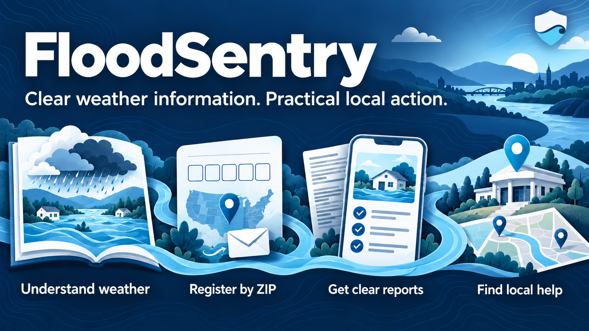

# FloodSentry

**Clear weather information. Practical local action.**



FloodSentry helps people understand dangerous weather and decide what to do next. It combines an illustrated weather guide with plain-language bulletin reports.

This U.S.-focused prototype was inspired by the Camp Mystic flooding in Texas. Its goal is clearer communication, not replacing official warnings.

## What the app does

- **Explain the weather.** Ten illustrated chapters cover causes, impacts, and precautions. Readers can explore extra science or print the guide.
- **Register by ZIP code.** Users enter an email, a five-digit U.S. ZIP code, and consent. An emailed code confirms access to their inbox.
- **Make bulletins easier to understand.** A pasted report becomes a summary, one or two damage paragraphs, and numbered protective actions.
- **Find local help.** Reports include source-checked assistance listings when available. Unverified locations are omitted, with Red Cross and 211 resources as fallbacks.

Reports show everyday language first. Exact bulletin identifiers and technical details appear afterward.

> **Current status:** This is a local prototype, not a live warning service. Bulletin submissions send one email to the project's test inbox. They do not broadcast to registered users.

## Judge tour

Allow about five minutes after setup. Education pages need no account or API key.

| Page | What to review |
| --- | --- |
| `/` — Home | The mission, storm cards, and links to the app's tools. |
| `/learn` — Weather guide | Ten illustrated topics, practical precautions, source links, and printable content. |
| `/register` — Register | Email validation, ZIP entry, consent, and inbox confirmation. |
| `/bulletin` — Upload bulletin | Plain-language reports, possible damage, protective actions, local help, and processing progress. |
| `/registrations` — Registrations | Local confirmed registrations and the removal option. Use only demonstration data. |
| `/errors` — Errors | Saved processing failures that help explain unsuccessful requests. |

### Review without sending email

1. Open the homepage and weather guide using the local setup below.
2. Expand a storm card. Follow a guide chapter and its source links.
3. Run `npm run email:preview` to generate an example report without calling external services.
4. Open `output/email-preview/index.html` in a browser. Review damage, actions, local help, and technical details.
5. Run the tests and production build using the commands below.

### Review the connected workflow

Configure the provider keys before this part. Submissions can incur API charges and send real email.

1. Start the API and frontend. Open `/bulletin` and select **Load sample**.
2. Review the historical Tennessee bulletin dated June 10, 2012. Loading it does not send anything.
3. Select **Prepare and send alert** to run the connected demonstration.
4. Review matched ZIP codes, expected damage, protective steps, and checked local-help sources.
5. Expand **Technical details** to inspect original identifiers, geographic coverage, and delivery status.
6. Optionally register a demonstration inbox. Enter its emailed code, then review or remove that registration.

The sample is not a current warning. Local-help research checks current sources, separately from the bulletin's historical date.

## Run locally

### Requirements

- Node.js 24, with npm. Development and tests have used Node.js 24.21.0.
- Internet access for dependency installation and the Census download.
- OpenAI and Resend credentials only for connected bulletin processing and registration confirmation.

### 1. Install and view the education pages

```bash
npm install
npm run dev
```

Open [http://localhost:5173](http://localhost:5173). The homepage and weather guide work without the local API.

### 2. Set up the full prototype

Stop the frontend before using `dev:all`, or run the API separately with `npm run dev:api`.

```bash
cp .env.example .env
npm run data:download
```

Edit `.env` with your own credentials:

```dotenv
OPENAI_API_KEY=your_openai_api_key
OPENAI_MODEL=gpt-4.1
RESEND_API_KEY=your_resend_api_key
RESEND_FROM_EMAIL="FloodSentry <alerts@your-verified-domain.example>"
```

Use a sender permitted by your Resend account. Test-sender restrictions may limit who can receive messages.

```bash
npm run dev:all
```

The frontend runs at `http://localhost:5173`. The API runs at `http://127.0.0.1:8787`.

The Census command downloads public county-to-ZIP-area data. The API creates its own local database; no private database is distributed.

Keep `.env` private. Never put provider keys in browser code or variables prefixed with `VITE_`.

## How a bulletin becomes a report

```text
Pasted bulletin
  → Extract affected counties and source details
  → Match counties to locally stored Census ZIP-area data
  → Draft the summary, possible damage, and protective steps
  → Search official sources and check local-help listings
  → Save the report in local SQLite
  → Send one report email to the project test inbox
```

The Node API normally makes three OpenAI requests: county extraction, report drafting, and web-enabled local-help research.

ZIP matching stays local. OpenAI receives bulletin and area information, not the subscriber directory or email addresses.

Local-help checks use government, Red Cross, and 211 sources. Listings include source links and check times when verification succeeds.

The app does not confirm opening, capacity, accessibility, or safe travel routes. Users must check those details before travel.

## Technology and code

| Part | Implementation |
| --- | --- |
| Interface | React, TypeScript, Vite, responsive CSS, and lightweight client-side routing. |
| Local API | Node.js HTTP server with streaming progress updates. |
| Data | SQLite for registrations, confirmation requests, reports, errors, and the Census crosswalk. |
| Report drafting | OpenAI Responses API with structured output. |
| Email | Resend, with HTML and plain-text reports and an embedded Wave Shield logo. |
| Optional trained model | ONNX Runtime in Node.js; disabled in the current user-facing workflow. |

Start with these files:

- [`src/pages/`](src/pages/) — page interfaces and the bulletin workflow.
- [`src/data/weatherGuide.ts`](src/data/weatherGuide.ts) — educational content and source links.
- [`server/weather-alerts.mjs`](server/weather-alerts.mjs) — bulletin analysis, ZIP matching, saving, and delivery orchestration.
- [`server/local-help.mjs`](server/local-help.mjs) — local-help research and source checks.
- [`server/email-templates.mjs`](server/email-templates.mjs) — resident report email formatting.
- [`server/subscription-verification.mjs`](server/subscription-verification.mjs) — emailed confirmation codes and registration checks.

### Trained model: implemented adapter, not a claimed prediction feature

The supplied ONNX classifier can run directly in Node.js. Its adapter validates a 14-number feature vector and returns a prediction label.

It is disabled by default and is not connected to bulletin conclusions. The original feature names and preprocessing must be mapped first.

The app does not claim validated damage-prediction accuracy. See the [developer guide](docs/DEVELOPMENT.md#trained-model-integration) for the integration boundary.

## Testing and review evidence

```bash
npm test
npm run build
npm run email:preview
```

The suite currently contains 75 automated tests. Tests use mock providers and in-memory databases; they do not send real email or incur provider charges.

Coverage includes registration validation, confirmation expiry, rate limits, targeted removal, bulletin parsing, report sections, source checks, escaping, and ONNX inference.

The build produces `dist/`. The offline email preview is generated separately in `output/email-preview/`.

## Privacy, safety, and prototype limits

- Active registrations store email, ZIP code, consent time, registration time, and confirmation time in `data/flood-sentry.sqlite`.
- Confirmation requests store hashed codes. Codes expire after ten minutes and have attempt and resend limits.
- Local databases, provider keys, generated previews, and development tools are excluded from Git.
- Registration lists and bulletin tools are unauthenticated local demonstration pages. Do not expose personal records on a public deployment.
- ZIP-area matches are approximate county coverage, not exact warning polygons or individual building forecasts.
- Possible damage is not presented as confirmed damage unless the supplied bulletin reports it.
- The app does not automatically monitor live weather, send SMS, or broadcast bulletin alerts to subscribers.
- Provider acceptance does not prove inbox delivery. Failed help research falls back to official assistance resources.
- Registration is free to users. Connected demonstrations can still incur OpenAI and email-provider costs.

Follow the National Weather Service and local emergency officials for live warnings. FloodSentry does not replace their instructions.

## Sources, design, and development assistance

The app links weather guidance from NOAA and the National Weather Service. Geographic matching uses the public 2020 Census ZCTA-to-county relationship file.

The navy-and-sky-blue interface uses one font, short sentences, keyboard focus styles, reduced-motion support, and expandable technical details.

The project was developed with AI assistance. Runtime AI use is described above. Generated cover artwork and its prompts are documented in [asset notes](docs/ASSETS.md).

## Deployment and next steps

Static hosting can publish the education interface using `npm run build` and the `dist/` folder. It does not deploy the Node API.

Public use needs an API host, private persistent storage, administrative access controls, and stronger unsubscribe verification.

Future work includes subscriber delivery, live bulletin ingestion, authenticated administration, and a validated trained-model feature mapping.

For API behavior, troubleshooting, and model details, see the [developer guide](docs/DEVELOPMENT.md).
